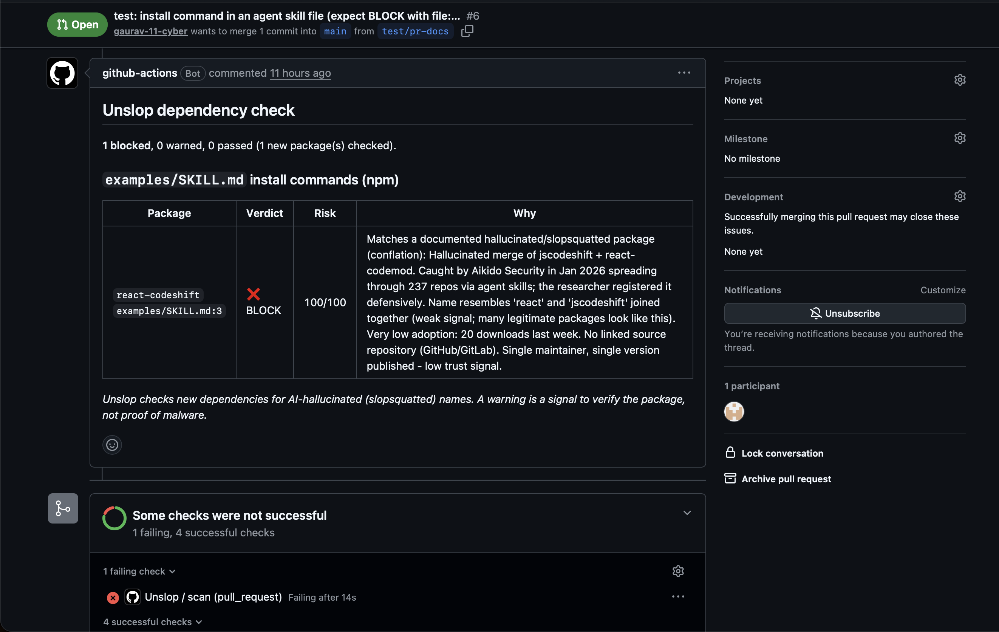
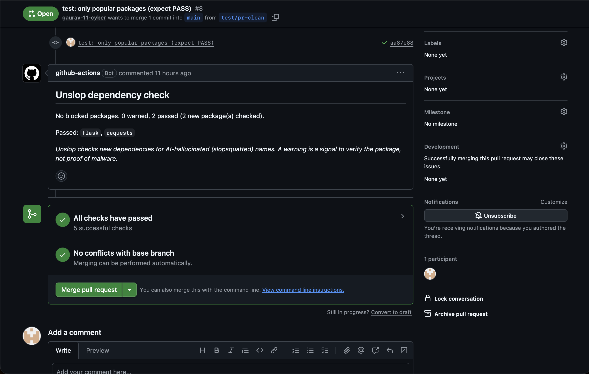
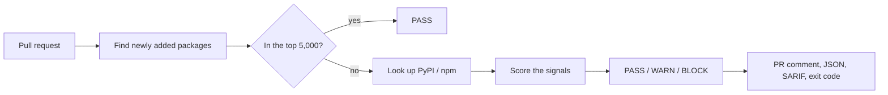

# Unslop

**Catch AI-hallucinated package names before they get installed.**

[](https://github.com/gaurav-11-cyber/Unslop/actions/workflows/tests.yml)


Unslop is a command-line tool and GitHub Action that checks the dependencies a pull request **adds** and blocks the ones that look hallucinated or squatted, on PyPI and npm.

## The problem in 30 seconds

AI coding assistants sometimes suggest packages that do not exist. A 2025 USENIX Security study found roughly **1 in 5** package names suggested by code models were made up. Attackers can register those names with malware inside, and the next person who runs `pip install` or `npm install` on the AI's suggestion installs it. This attack is called **slopsquatting**, and it has already happened:

- `huggingface-cli`: a researcher registered a harmless placeholder for a name AI tools kept suggesting. It got 30,000+ real downloads in three months.
- `react-codeshift`: a name an AI invented by merging two real packages. It spread through 237 repositories via agent skill files before a researcher claimed it defensively.

Most scanners look at the dependency file. These names also travel through READMEs, setup scripts, Dockerfiles, CI files and AI agent instruction files, so Unslop reads those too.

## What it does

- **Scans only what a pull request adds**, so results stay short and relevant.
- **Reads many file types:** `requirements.txt`, `package.json`, `package-lock.json`, `pyproject.toml`, plus `pip install` / `npm install` commands inside Markdown, shell scripts, Dockerfiles and CI YAML.
- **Gives each new package a verdict** (PASS, WARN or BLOCK), a 0 to 100 risk score, and the reasons in plain words.
- **Comments on the pull request** and fails the check on a BLOCK. It also writes JSON and SARIF (for GitHub code scanning).

Example output:

```text
$ unslop scan package.json requirements.txt --base origin/main
✗ BLOCK  react-codeshift  (risk: 90/100)
✗ BLOCK  reqeusts         (risk: 60/100)
✓ PASS   react            (risk: 0/100)
Summary: 2 blocked, 0 warned, 1 passed.
```

A pull request comment from the Action, blocking an install command found in an agent skill file:



A pull request that only adds well-known packages passes without noise:



## How it decides



| Signal | What it means |
|---|---|
| Documented incident | The name is in a small, sourced list of known cases |
| Does not exist | A hallucinated name that nobody has registered yet |
| Typosquat | One character away from a popular package (for example `reqeusts`) |
| npm security placeholder | npm removed the original package as malware |
| Registry metadata | Very new, few downloads, no source repository, one maintainer |
| Name resembles two packages | Weak hint only; never a warning on its own |

Registry outages are reported as "could not verify", never as "does not exist".

## Quick start

Requires Python 3.11 or newer.

```bash
pip install git+https://github.com/gaurav-11-cyber/Unslop.git

unslop scan requirements.txt                        # scan a whole file
unslop scan package.json --base origin/main         # only packages added since main
unslop scan README.md SKILL.md                      # install commands in docs and agent files
```

Useful options: `--markdown FILE`, `--json FILE`, `--sarif FILE`, `--only a,b`, `--strict-docs`, `--no-cache`, `--no-fail-on-block`.
Exit codes: `0` nothing blocked, `1` a package was blocked, `2` the scan could not run.

### Use it as a GitHub Action

```yaml
name: Unslop
on: pull_request
permissions:
  contents: read
  pull-requests: write
  security-events: write
jobs:
  scan:
    runs-on: ubuntu-latest
    steps:
      - uses: actions/checkout@v4
        with:
          fetch-depth: 0
          persist-credentials: false
      - uses: gaurav-11-cyber/Unslop@v0.2.0
```

It uses `pull_request`, not `pull_request_target`, so code from forks never runs with your secrets. Inputs: `comment`, `fail-on-block`, `strict-docs`, `python-version`.

## How well does it work?

Measured on a held-out split of 600 legitimate and 600 malicious package names (PyPI and npm). Malicious labels come from the OpenSSF malicious-packages repository; rule settings were tuned on a separate dev split.

| Check | Result |
|---|---|
| Lesser-known legitimate packages wrongly flagged | **0 of 600** (95% confidence interval up to 1.3% per ecosystem) |
| Typosquat rule, malicious PyPI names | catches 8.7% at a 2.3% false-positive rate |
| Typosquat rule, malicious npm names | 0% (the sample is mostly random spam names, not typosquats) |
| Malicious packages that are still live and look ordinary | **0 of 119 flagged** |

**Honest reading:** Unslop is a low-noise gate for hallucinated and squatted names. It is **not** a general malware scanner. Details, method and limits are in [`eval/results.md`](eval/results.md).

## Limits

- "Malicious" is not the same as "AI-hallucinated". No labelled set of hallucinated names was available, so that claim rests on the existence check and the incident list, and is not measured.
- Scores and weights are set by judgment, not fitted. The "resembles two packages" rule showed no recall on the sample and is kept as a weak hint.
- A registry outage means a warning, not a block, so a gate that cannot reach PyPI lets packages through.
- Top-5,000 packages are trusted by name and skip lookups. A hijacked popular package is out of scope.

## Related work

Other open-source projects tackle slopsquatting, including two named SlopGuard (a Ruby one by Aditya Tiwari and a Python one), plus commercial tools such as Socket and Snyk. Unslop's emphasis is a diff-based pull request gate, scanning of docs and agent files, and a published evaluation with stated limits.

## Development

```bash
git clone https://github.com/gaurav-11-cyber/Unslop.git && cd Unslop
python3 -m venv venv && source venv/bin/activate
pip install -e ".[dev]"
pytest -q                      # 65 offline tests
python scripts/e2e_cli.py      # 39 end-to-end cases against the real registries
```

```text
unslop/         scanner, scoring rules, registry client, docs parser, SARIF and report output
action.yml      reusable GitHub Action
eval/           labelled datasets, evaluation scripts, results
scripts/        end-to-end tests, comparison-list builder, test-PR helper
tests/          unit tests, including the Action's shell step
```

See [CHANGELOG.md](CHANGELOG.md) and [SECURITY.md](SECURITY.md). Licensed under the [MIT License](LICENSE).
